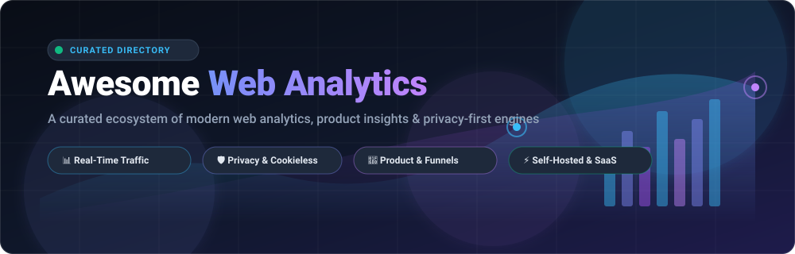

<p align="center">
  
</p>

# 📊 Awesome Web Analytics

<p align="center">
  <a href="https://github.com/ishandutta2007/Awesome-Awesome-Awesome"></a>
  <a href="https://discord.gg/jc4xtF58Ve"></a>
  <a href="https://github.com/ishandutta2007/Awesome-Web-Analytics/stargazers"></a>
  <a href="https://github.com/ishandutta2007/Awesome-Web-Analytics/network/members"></a>
  <a href="https://github.com/ishandutta2007/Awesome-Web-Analytics/pulls"></a>
  <a href="https://github.com/ishandutta2007/Awesome-Web-Analytics/blob/main/LICENSE"></a>
  <a href="https://github.com/ishandutta2007"></a>
</p>

> 🚀 **A comprehensive, SEO-optimized directory of SaaS platforms, self-hosted solutions, privacy-first engines, and open-source Google Analytics alternatives.**  
> *Track website traffic, event telemetry, customer funnels, and cookieless user insights while ensuring GDPR/CCPA compliance.*

---

## 📑 Table of Contents

- [🌐 Sector Overview & Market Dynamics](#-sector-overview--market-dynamics)
- [💼 SaaS & Hosted Analytics Platforms](#-saas--hosted-analytics-platforms)
- [⭐ Open-Source GitHub Projects](#-open-source-github-projects)
- [💡 Architectural Guide: How to Choose](#-architectural-guide-how-to-choose)
- [🏷️ SEO Keywords & Taxonomy](#️-seo-keywords--taxonomy)
- [🤝 How to Contribute](#-how-to-contribute)
- [💖 Support & Sponsoring](#-support--sponsoring)
- [📈 Star History](#--star-history)
- [📜 License & Disclaimer](#-license--disclaimer)

---

## 🌐 Sector Overview & Market Dynamics

- **Estimated Market Size**: The global web analytics market was valued at **$5.3 Billion in 2024** and is projected to expand to **$15.8 Billion by 2032**, registering a robust compound annual growth rate (CAGR) of **~14.6%**, catalyzed by exponential digital commerce growth, omnichannel marketing attribution, and real-time behavioral data ingestion.
- **Market Dynamics & Fragmentation**: The web analytics space displays a distinct **barbell, moderately-to-highly fragmented landscape**. On one end, mega-cap platforms like Google Analytics (Alphabet) and Adobe Analytics dominate aggregate market share (powering over 65% of all ranked web properties) in high-volume advertising ecosystems. On the other end, strict international privacy regulations (GDPR, PECR, CCPA), Safari/Firefox cookie blocking, and ad-blockers have fueled an explosion of fragmented, high-growth alternatives: privacy-first cookieless platforms (Plausible, Fathom, Umami), developer-centric event orchestrators (PostHog, RudderStack), and fully self-hosted data solutions where companies retain 100% data residency.

---

## 💼 SaaS & Hosted Analytics Platforms

Below is a curated breakdown of leading hosted and commercial SaaS web analytics platforms. The table is **sorted descending by company size / market valuation**.

| Platform | Company Valuation / Size | Starting Tier Price | Free Tier / Trial Limit | Key Focus & Capabilities |
| :--- | :--- | :--- | :--- | :--- |
| **[Google Analytics](https://analytics.google.com/)** | **~$2.10 Trillion** *(Alphabet Inc. Market Cap)* | **$0/mo** *(Standard GA4)* / **$50,000/yr** *(GA4 360 Enterprise)* | **Free Forever**: Up to 10M events/month per property, 50 custom event dimensions, BigQuery raw export, 14-month data retention. | Industry standard web & mobile tracking, native integration with Google Ads and BigQuery. |
| **[Adobe Analytics](https://business.adobe.com/products/analytics/adobe-analytics.html)** | **~$220 Billion** *(Adobe Inc. Market Cap)* | **$2,000/mo** *(~$24k–$30k/yr Select contract)* | **30-day enterprise sandbox/trial** *(arranged via sales engineering demo)*; no permanent free tier. | Enterprise omnichannel customer intelligence, advanced multi-touch attribution, predictive modeling. |
| **[Heap](https://heap.io/)** | **~$5.60 Billion** *(Contentsquare Valuation)* | **$300/mo** *(~$3,600/yr Growth tier billed annually)* | **Free Forever**: Up to 10,000 sessions/month, automatic retroactive autocapture, 6-month retention, unlimited seats. | Complete retroactive autocapture for clicks, swipes, and page interactions without manual tagging. |
| **[Amplitude](https://amplitude.com/)** | **~$1.20 Billion** *(Public: NASDAQ: AMPL)* | **$49/mo** *(Plus plan, billed annually)* | **Free Forever (Starter plan)**: Up to 50,000 monthly tracked users (MTUs), unlimited events/retention, core funnels & cohorts. | Advanced product analytics, behavioral cohort segmentation, retention funnels, and feature experimentation. |
| **[Mixpanel](https://mixpanel.com/)** | **~$1.05 Billion** *(Unicorn Valuation)* | **$28/mo** *(Growth tier up to 10,000 MTUs)* | **Free Forever**: Up to 20,000 monthly tracked users (MTUs), unlimited events, core cohort charts, real-time alerts. | Self-serve event product analytics, interactive user conversion funnels, and lifecycle tracking. |
| **[Matomo Cloud](https://matomo.org/)** | **~$10 Million ARR** *(InnoCraft)* | **$23/mo** *(Cloud plan up to 50,000 hits/month)* | **21-day free trial** *(full cloud feature set up to 50,000 hits; 100% free forever if self-hosted)*; no permanent cloud tier. | Privacy-compliant Google Analytics replacement offering 100% data ownership, heatmaps, and session recording. |
| **[Woopra](https://www.woopra.com/)** | **~$5 Million ARR** *(Woopra Inc.)* | **$999/mo** *(Pro plan for 1M actions/month)* | **Free Forever (Core plan)**: Up to 500,000 actions/month, 90-day retention, 30+ integrations, core funnel reports. | Real-time omnichannel customer journey tracking, user profile timelines, and trigger automation. |
| **[Fathom Analytics](https://usefathom.com/)** | **~$2.5 Million ARR** *(Conva Ventures)* | **$15/mo** *(Starting tier up to 100,000 monthly pageviews)* | **30-day free trial** *(full access to all features up to 100k pageviews during trial period)*; no permanent free tier. | Privacy-first website analytics, cookieless tracking, GDPR/CCPA compliance, ultra-light script (<2KB). |
| **[Plausible Analytics Cloud](https://plausible.io/)** | **~$2.0 Million ARR** *(Plausible Insights)* | **$9/mo** *(Starting tier up to 10,000 monthly pageviews)* | **30-day free trial** *(unlimited pageviews and complete dashboard capabilities)*; no permanent free cloud tier. | Lightweight (<1KB script), cookie-free, open-core dashboard focused on speed, clarity, and compliance. |
| **[Simple Analytics](https://simpleanalytics.com/)** | **~$500,000 ARR** *(Simple Analytics B.V.)* | **$9/mo** *(Starter plan up to 10,000 pageviews/month)* | **14-day free trial** *(full dashboard features, up to 10k pageviews)*; no permanent free tier. | Cookieless privacy analytics built in the EU, zero IP tracking, natural language AI analytics assistant. |

---

## ⭐ Open-Source GitHub Projects

Curated list of self-hostable open-source web analytics, behavioral pipelines, and event platforms.  
**Sorted descending by GitHub stargazer count.**

### 1. [PostHog](https://github.com/PostHog/posthog) [](https://github.com/PostHog/posthog/stargazers)
- **Description**: The open-source all-in-one product analytics suite. Features product telemetry, event tracking, session replay, heatmaps, feature flags, A/B testing experiments, user surveys, and data warehouse integration.
- **Tech Stack**: Python / Django / React / ClickHouse / Kafka / PostgreSQL
- **Key Advantage**: Replaces Amplitude, Mixpanel, and LaunchDarkly with a single self-hostable stack.

### 2. [Umami](https://github.com/umami-software/umami) [](https://github.com/umami-software/umami/stargazers)
- **Description**: Simple, fast, privacy-focused open-source alternative to Google Analytics. Collects only non-identifiable metrics, generates no cookies, bypasses ad-blockers easily when proxied, and offers an ultra-clean UI.
- **Tech Stack**: Node.js / Next.js / Prisma / PostgreSQL / MySQL
- **Key Advantage**: Zero cookies, sub-megabyte runtime, multi-tenant dashboard, easy Docker deployment.

### 3. [Plausible Analytics](https://github.com/plausible/analytics) [](https://github.com/plausible/analytics/stargazers)
- **Description**: Lightweight, open-source, and privacy-respecting website analytics. Provides a simple one-page dashboard showing referral sources, top pages, countries, screen sizes, goals, and custom events.
- **Tech Stack**: Elixir / Phoenix / ClickHouse / PostgreSQL
- **Key Advantage**: Script size is under 1KB (45x lighter than GA4), requires no cookie banners, handles high concurrency via ClickHouse.

### 4. [Matomo](https://github.com/matomo-org/matomo) [](https://github.com/matomo-org/matomo/stargazers)
- **Description**: The leading enterprise-grade open-source analytics platform (formerly Piwik). Offers 100% data ownership, tag management, goals, custom dimensions, heatmaps, session recordings, and enterprise plugins.
- **Tech Stack**: PHP / MySQL / MariaDB
- **Key Advantage**: The closest 1:1 open-source replacement for Google Analytics 360 with comprehensive GDPR tooling.

### 5. [GoAccess](https://github.com/allinurl/goaccess) [](https://github.com/allinurl/goaccess/stargazers)
- **Description**: Real-time web log analyzer and interactive viewer that runs directly in your terminal or via an interactive HTML report in the browser. Reads Nginx, Apache, Caddy, Cloudflare, or AWS logs.
- **Tech Stack**: C / ncurses
- **Key Advantage**: 100% server-side with zero JavaScript tracking snippet on client browsers, immune to ad-blockers and privacy blockers.

### 6. [Snowplow](https://github.com/snowplow/snowplow) [](https://github.com/snowplow/snowplow/stargazers)
- **Description**: Enterprise-grade behavioral data pipeline. Collects high-fidelity, schema-validated event data across web, mobile, and server applications directly into your cloud data warehouse (Snowflake, BigQuery, Databricks).
- **Tech Stack**: Scala / Spark / Kafka / Cloud-native IaC
- **Key Advantage**: Complete warehouse-native data architecture with strict JSON schema enforcement and immutable event logging.

### 7. [GoatCounter](https://github.com/arp242/goatcounter) [](https://github.com/arp242/goatcounter/stargazers)
- **Description**: Simple, privacy-aware web analytics without tracking personal data. Can be used as a hosted service or a standalone single binary on a $5/mo VPS.
- **Tech Stack**: Go / SQLite / PostgreSQL
- **Key Advantage**: Single Go binary with zero external dependencies, extremely light memory footprint, no cookie consent needed.

### 8. [Countly](https://github.com/Countly/countly-server) [](https://github.com/Countly/countly-server/stargazers)
- **Description**: Open-source product analytics platform built for web, mobile apps, desktop software, and IoT devices. Tracks sessions, crashes, push notifications, and user attribution.
- **Tech Stack**: Node.js / MongoDB
- **Key Advantage**: Exceptional support for cross-platform mobile apps (iOS, Android, React Native, Flutter, Unity).

### 9. [Jitsu](https://github.com/jitsucom/jitsu) [](https://github.com/jitsucom/jitsu/stargazers)
- **Description**: Open-source, high-performance data collection platform and Segment alternative. Captures events from web and mobile apps and streams them in real-time to warehouses and marketing tools.
- **Tech Stack**: TypeScript / Go / ClickHouse / Redis
- **Key Advantage**: Seamless event collection, transformation functions, and schema generation with ClickHouse backing.

### 10. [Ackee](https://github.com/electerious/Ackee) [](https://github.com/electerious/Ackee/stargazers)
- **Description**: Self-hosted, privacy-oriented Node.js analytics tool. Tracks visitors, referrers, and duration without storing personally identifiable information.
- **Tech Stack**: Node.js / GraphQL / MongoDB
- **Key Advantage**: Clean minimalist UI with GraphQL API for developers wanting programmatic access.

### 11. [RudderStack](https://github.com/rudderlabs/rudder-server) [](https://github.com/rudderlabs/rudder-server/stargazers)
- **Description**: Warehouse-native customer data platform (CDP). Collects web events, mobile events, and server webhooks and routes them securely to 180+ analytics, marketing, and warehouse destinations.
- **Tech Stack**: Go / PostgreSQL
- **Key Advantage**: Full developer-first Segment alternative that prioritizes cloud data warehouse ownership.

### 12. [Shynet](https://github.com/milesmcc/shynet) [](https://github.com/milesmcc/shynet/stargazers)
- **Description**: Modern, privacy-friendly, and cookie-free web analytics service. Doesn't use cookies or local storage, and works even when JavaScript is disabled using pixel fallbacks.
- **Tech Stack**: Python / Django / PostgreSQL
- **Key Advantage**: Built-in 1-pixel image fallback tracking for JS-disabled clients, script blockers, and email read telemetry.

### 13. [Open Web Analytics (OWA)](https://github.com/Open-Web-Analytics/Open-Web-Analytics) [](https://github.com/Open-Web-Analytics/Open-Web-Analytics/stargazers)
- **Description**: Mature open-source alternative to commercial web analytics suites. Delivers heatmaps, mouse tracking, DOM click recording, conversion goals, and WordPress integration.
- **Tech Stack**: PHP / MySQL
- **Key Advantage**: Built-in mouse click heatmaps and session replay without third-party external subscriptions.

### 14. [Aptabase](https://github.com/aptabase/aptabase) [](https://github.com/aptabase/aptabase/stargazers)
- **Description**: Open-source, privacy-first, lightweight analytics engine tailored for websites, native desktop, and mobile applications (iOS, Android, macOS, Windows, Linux).
- **Tech Stack**: Rust / ClickHouse / Svelte
- **Key Advantage**: Blazing-fast Rust ingestion engine with minimal memory consumption.

### 15. [Swetrix](https://github.com/swetrix/swetrix) [](https://github.com/swetrix/swetrix/stargazers)
- **Description**: Fully open-source, GDPR-compliant web analytics platform with cookieless tracking, live visitor counters, performance monitoring, and error alerts.
- **Tech Stack**: TypeScript / Node.js / ClickHouse / Redis
- **Key Advantage**: Includes website performance metrics (Core Web Vitals) alongside regular traffic analytics.

### 16. [Offen Fair Analytics](https://github.com/offen/offen) [](https://github.com/offen/offen/stargazers)
- **Description**: Fair, lightweight, self-hosted web analytics where operators and website visitors both gain access to the collected data through an auditable, consent-first interface.
- **Tech Stack**: Go / JavaScript / Docker
- **Key Advantage**: Consent-first opt-in model that shares analytics data reciprocally with end users.

### 17. [Medama](https://github.com/medama-io/medama) [](https://github.com/medama-io/medama/stargazers)
- **Description**: Ultra-fast, privacy-focused open-source website analytics engine powered by SQLite and DuckDB. Single-binary deployment with sub-second queries.
- **Tech Stack**: Go / SQLite / DuckDB
- **Key Advantage**: Extremely light on hardware resources; can run millions of monthly pageviews on an entry-level VPS.

---

## 💡 Architectural Guide: How to Choose

```
                                  [ What is your primary need? ]
                                                │
         ┌──────────────────────────────────────┼──────────────────────────────────────┐
         ▼                                      ▼                                      ▼
┌──────────────────┐                  ┌──────────────────┐                  ┌──────────────────┐
│ Simple & Privacy │                  │ Product Analytics│                  │ Enterprise Scale │
│ Website Traffic  │                  │ & User Funnels   │                  │ & Ad Attribution │
└────────┬─────────┘                  └────────┬─────────┘                  └────────┬─────────┘
         │                                      │                                      │
  ┌──────┴──────┐                        ┌──────┴──────┐                        ┌──────┴──────┐
  ▼             ▼                        ▼             ▼                        ▼             ▼
SaaS          Self-Host                SaaS          Self-Host                SaaS          Warehouse
Plausible     Umami                    Mixpanel      PostHog                  Google        Snowplow
Fathom        GoatCounter              Amplitude     Countly                  Analytics     RudderStack
SimpleAnalyt. GoAccess                 Heap          Jitsu                    Adobe         ClickHouse
```

1. **For Personal Sites, Blogs & Indie Hackers**:
   - *Best SaaS*: [Plausible](https://plausible.io/) or [Fathom](https://usefathom.com/) (instant setup, no cookies, beautiful UI).
   - *Best Self-Hosted*: [Umami](https://github.com/umami-software/umami) or [GoatCounter](https://github.com/arp242/goatcounter) (low memory, Docker/VPS ready).
2. **For SaaS Startups & Product Managers**:
   - *Best SaaS*: [Mixpanel](https://mixpanel.com/) or [Amplitude](https://amplitude.com/) (funnels, retention curves, user cohorting).
   - *Best Self-Hosted*: [PostHog](https://github.com/PostHog/posthog) (feature flags, session recordings, A/B experiments).
3. **For Full Data Ownership & GDPR Compliance**:
   - *Best On-Premise Suite*: [Matomo](https://github.com/matomo-org/matomo) (heatmaps, custom dimensions, tag manager).
   - *Best Server-Side Analyzer*: [GoAccess](https://github.com/allinurl/goaccess) (reads server logs, 0% client tracking code).
4. **For Data Engineering & Modern Warehouse Stacks**:
   - *Best Pipeline*: [Snowplow](https://github.com/snowplow/snowplow) or [RudderStack](https://github.com/rudderlabs/rudder-server) (stream raw events into Snowflake, BigQuery, or ClickHouse).

---

## 🏷️ SEO Keywords & Taxonomy

`web-analytics` • `privacy-first-analytics` • `cookieless-tracking` • `google-analytics-alternative` • `self-hosted-analytics` • `open-source-analytics` • `product-analytics` • `gdpr-compliant-tracking` • `event-telemetry` • `behavioral-analytics` • `clickstream-data` • `visitor-tracking` • `matomo` • `umami` • `plausible` • `posthog` • `server-side-analytics` • `traffic-measurement`

---

## 🤝 How to Contribute

Contributions are warmly welcomed! Help make this the most complete, factual, and useful web analytics reference on GitHub:

1. 🍴 **Fork** this repository.
2. 🌿 Create a descriptive feature branch (`git checkout -b add-my-analytics-tool`).
3. 📝 Update `README.md` following the established formatting, table structure, or star badge conventions.
4. 🔍 Keep descriptions neutral, factual, and include official links.
5. 🚀 Submit a **Pull Request** with a concise summary of the changes.

---

## 💖 Support & Sponsoring

A huge thank you to all contributors, maintainers, and stargazers in the web analytics community!  
If you find this curated directory helpful for your projects, architecture decisions, or company:

- ⭐ **Star** this repository to help other developers and founders discover it.
- 🍴 **Fork** it to keep a personal offline reference or suggest new additions.
- 📢 **Share** this list on X/Twitter, LinkedIn, Discord, or your engineering blog.
- ☕ **Sponsor**: If you'd like to support ongoing updates, maintenance, and future open-source collections, consider buying a coffee via the [GitHub Sponsor Dashboard](https://github.com/sponsors/ishandutta2007).

---

##  Star History

[](https://star-history.dera.page/#ishandutta2007/Awesome-Web-Analytics&type=date&legend=top-left)

---

## 📜 License & Disclaimer

- **License**: Released under the [MIT License](LICENSE).
- **Disclaimer**: This directory is curated for informational purposes. Web analytics platforms process end-user telemetry; ensure proper privacy notices, consent banners, and regulatory compliance (GDPR, CCPA, ePrivacy) before implementing any tracking solution in production environments.
